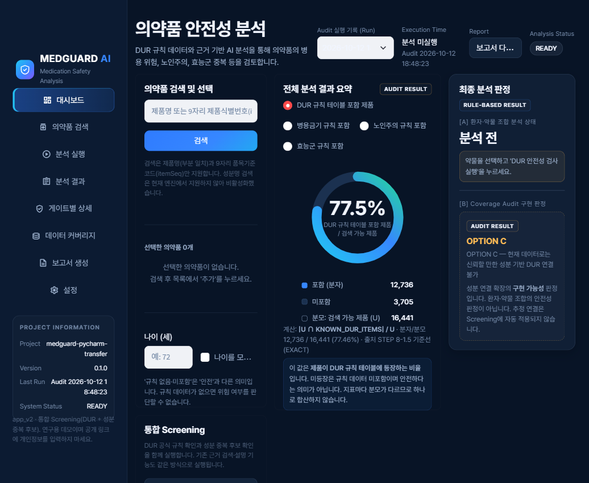
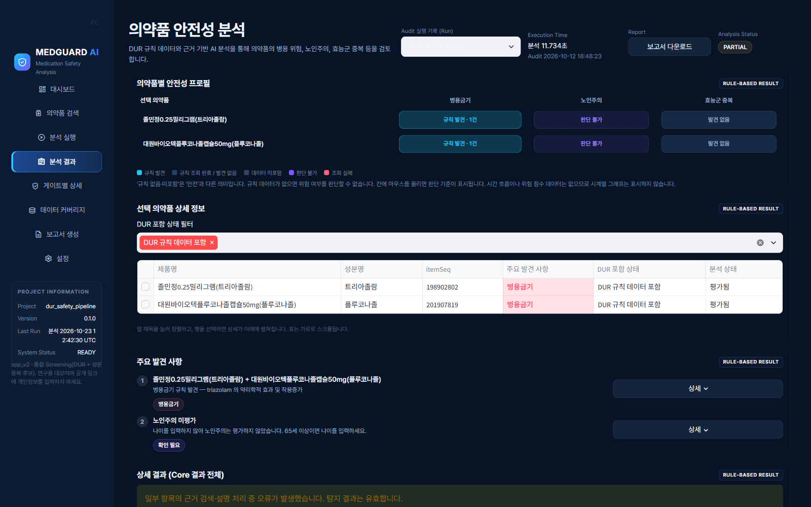
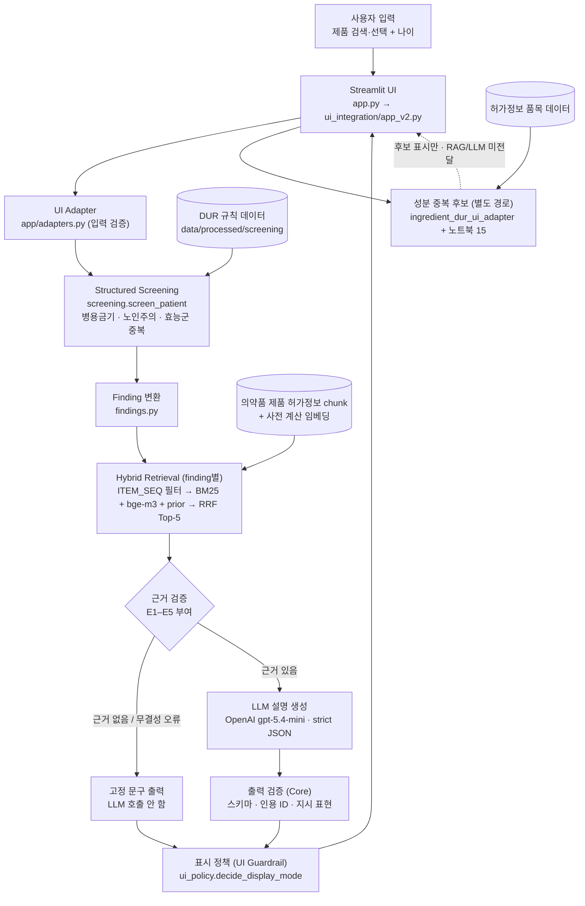

# MEDGUARD AI

**한국 DUR 규칙 기반 다제약물(Polypharmacy) 안전성 Screening과 허가정보 근거 기반 설명 생성 — 연구용 프로토타입**

> ⚠️ **연구·포트폴리오용 프로토타입입니다. 실제 의료 의사결정에 쓰도록 검증된 시스템이 아닙니다.**
> `CLINICAL_VALIDATION_STATUS = NOT_VALIDATED` · `OFFICIAL_INGREDIENT_IDENTITY_STATUS = NO-GO`
> 결과는 진단·처방·복용 판단과 의료 전문가의 검토를 대신하지 않습니다. 실제 환자 정보를 입력하지 마세요.

여러 약을 함께 복용할 때 확인해야 하는 병용금기·노인주의·효능군 중복을 **식품의약품안전처 DUR 규칙 데이터로 결정적으로(deterministic) 조회**합니다.
그다음 탐지된 항목마다 **공식 의약품 허가정보에서 근거를 검색(Hybrid RAG)** 하고, LLM이 그 근거만 인용해 설명을 만듭니다.
위험 판정은 규칙 엔진이 하고, LLM은 이미 내려진 판정을 설명만 합니다. 생성된 설명은 검증 규칙(Guardrail)을 통과할 때만 화면에 표시됩니다.
간호학 지식과 AI·데이터 기술을 연결하는 포트폴리오 프로젝트입니다.

<p align="center">
  
  
</p>
<p align="center"><sub>왼쪽: 대시보드(검색·나이 입력, DUR 데이터 커버리지). 오른쪽: 병용금기 탐지 결과. 설명 생성 API가 실패해도 Screening 결과는 그대로 표시됩니다. 출처: STEP 8 로컬 통합 검증 캡처.</sub></p>

---

## 목차

1. [개발 배경](#1-개발-배경)
2. [핵심 설계 원칙](#2-핵심-설계-원칙)
3. [주요 기능과 검증 수준](#3-주요-기능과-검증-수준)
4. [시스템 아키텍처](#4-시스템-아키텍처)
5. [기술 스택](#5-기술-스택)
6. [데이터 출처](#6-데이터-출처)
7. [평가 및 검증 결과](#7-평가-및-검증-결과)
8. [실행 방법](#8-실행-방법)
9. [프로젝트 한계](#9-프로젝트-한계)
10. [향후 개선 방향](#10-향후-개선-방향)
11. [저장소 구조와 문서 안내](#11-저장소-구조와-문서-안내)

---

## 1. 개발 배경

| 질문 | 이 프로젝트의 관점 |
|---|---|
| 다제약물 복용에서 무엇이 문제인가? | 함께 쓰면 안 되는 조합(병용금기), 고령자에게 주의가 필요한 약(노인주의), 같은 효능군 약의 중복이 처방 과정에서 놓일 수 있습니다. 식약처는 이런 항목을 DUR 규칙으로 공개합니다. |
| 왜 규칙 기반 Screening인가? | "이 조합이 DUR 규칙에 있는가"는 생성 모델이 추론할 문제가 아니라 공식 표를 조회하면 되는 문제입니다. 결정적 조회는 같은 입력에 같은 결과를 내고, 어떤 규칙에 걸렸는지 추적할 수 있습니다. |
| 왜 RAG를 결합했는가? | DUR 규칙 문구는 짧아서 "왜 주의해야 하는지"를 설명하기 어렵습니다. 해당 제품의 허가정보(사용상 주의사항 등)에서 관련 문단을 찾아 근거로 보여 줍니다. |
| 왜 LLM 단독 판단을 쓰지 않았는가? | LLM은 근거 없는 의학 정보를 만들거나 위험을 축소·확대할 수 있습니다. 그래서 LLM에게 판정 권한을 주지 않고 설명만 맡겼습니다. 출력은 구조화된 형식과 근거 ID 인용을 지켜야 표시됩니다. |

## 2. 핵심 설계 원칙

1. **판정은 규칙, 설명은 LLM.** 시스템 프롬프트는 Screening 결과를 "이미 결정된 사실"로 주고 재판정을 금지합니다. 코드도 출력의 `finding_id`·`risk_type`이 입력과 다르면 무효로 처리합니다(`src/dur_safety/generation.py`).
2. **근거 범위 제한.** 검색은 탐지된 제품(`ITEM_SEQ`)의 허가정보 안에서만 합니다. LLM은 그 근거에 `[E1]`~`[E5]` 형식의 ID를 붙여 인용해야 합니다.
3. **실패하면 닫는다(fail-closed).** 근거가 없거나 출력 검증에 실패하면 LLM 설명을 표시하지 않습니다. 그래도 Screening 결과와 DUR 기준 문구, 허가정보 원문은 계속 보여 줍니다. 데이터 SHA256이나 모델 revision이 평가 당시와 다르거나 임베딩 모델을 불러오지 못하면, BM25 단독으로 축소하지 않고 검색·분석 기능을 비활성화합니다.
4. **"발견되지 않음 ≠ 안전".** 규칙에 없는 조합을 안전하다고 표시하지 않습니다. 화면 문구에서도 "안전합니다" 같은 표현을 금지합니다.
5. **Frozen Core.** 평가를 마친 판정·검색·생성 모듈 9개는 SHA256으로 고정했습니다(`src/dur_safety/FROZEN_SHA256SUMS.txt`). 노트북 원본과는 AST 단위로 동등성을 시험합니다.

## 3. 주요 기능과 검증 수준

기능마다 검증 수준이 다릅니다. "검증" 열의 PASS는 **소프트웨어 동작과 재현성**을 뜻하며 임상적 정확성을 뜻하지 않습니다.

| 기능 | 설명 | 구현 | 검증 상태 |
|---|---|---|---|
| 의약품 검색 | 제품명(부분 일치) 또는 9자리 품목기준코드로 후보를 보여 줍니다. 자동 선택은 하지 않습니다. | `src/dur_safety/drug_lookup.py` | 평가 범위 밖의 입력 보조 기능 |
| 병용금기 Screening | 선택한 제품의 모든 쌍을 DUR 병용금기 쌍 표와 대조합니다. | `screening.check_contraindications` | 회귀 32/32, UI↔Core 30/30 일치 |
| 노인주의 Screening | 나이가 65세 이상이면 DUR 노인주의 표를 조회합니다. 나이를 입력하지 않으면 "평가하지 않음"으로 표시합니다. | `screening.check_elderly_caution` | 위와 같음 |
| 효능군 중복 Screening | 같은 DUR 효능군(9개)에 속한 제품이 2개 이상이면 탐지합니다. | `screening.check_therapeutic_duplication` | 위와 같음 |
| 성분 중복 **후보** | 허가정보 성분 코드가 같은 제품 쌍을 **미검증 후보**로 표시합니다. 공식 DUR 규칙이 아니며 RAG/LLM에 전달하지 않습니다. | `ui_integration/ingredient_dur_ui_adapter.py` + 노트북 15 | 공식 성분 동일성 **NO-GO**. 후보 표시 기능일 뿐입니다 |
| 근거 검색 (Hybrid RAG) | BM25 + 밀집 임베딩(bge-m3) + 위험 유형별 prior를 RRF로 결합해 Top-5를 고릅니다. | `src/dur_safety/retrieval.py` | 사람 라벨 30건 기준 hit@5 1.00, nDCG@5 0.734 ([§7](#7-평가-및-검증-결과)) |
| 근거 기반 설명 생성 | OpenAI `gpt-5.4-mini`, 엄격한 JSON 스키마, 근거 ID 인용. 키가 없으면 이 기능만 꺼집니다. | `src/dur_safety/generation.py` | 저장 출력 30건 + 실제 호출 15건. 근거 모순 1건 재현 |
| Guardrail (표시 정책) | 스키마·인용 검증, 지시/안심/Screening 부정 표현 차단, 실패 시 원문만 표시 | `generation.validate_output`, `app/ui_policy.py` | 합성 위험 응답 통과 7.5%. **의미 수준 모순은 검사하지 않음** |
| Streamlit UI | 대시보드, 의약품 검색, 분석 실행·결과, 게이트별 상세, 데이터 커버리지, 보고서, 설정 | `app.py` → `ui_integration/app_v2.py`, `app/` | 로컬 Windows·Linux(WSL2)에서 실행 확인. 공개 배포 없음 |

## 4. 시스템 아키텍처



| 모듈 | 역할 |
|---|---|
| `app.py` | 진입점. 필수 파일 16개를 확인하고, Streamlit Secrets를 환경변수로 옮긴 뒤 `ui_integration/app_v2.py`를 실행합니다 |
| `app/ui_runtime.py` | Frozen Core 자원을 프로세스당 한 번 로딩합니다. 실패하면 검색·실행을 비활성화합니다 |
| `app/adapters.py`, `app/view_models.py` | Core 결과를 화면용 구조로 바꿉니다. 판정은 바꾸지 않습니다 |
| `app/ui_policy.py` | 화면 문구와 LLM 설명의 표시/보류 결정(UI Guardrail) |
| `src/dur_safety/` (Frozen) | `screening` · `findings` · `retrieval` · `generation` · `pipeline` · `resources`(데이터 SHA256·모델 revision 검증) · `drug_lookup` · `config` |
| `ui_integration/ingredient_dur_ui_adapter.py` | 성분 중복 후보 Screening. 노트북 15·16에서 실행 확인한 코드 셀을 그대로 옮겨 실행합니다(판정 로직 재구현 없음) |
| `app/utils/audit_reader.py` | `reports/*_audit/` 결과를 읽어 게이트·커버리지 화면에 표시합니다 |

LLM 요청은 finding 1개당 1회입니다(네트워크 오류 시 SDK 재시도 최대 2회). 근거가 없는 finding에는 호출하지 않습니다. 설계와 화면별 동작은 [docs/EVALUATION.md](docs/EVALUATION.md)의 Guardrail 절에서 더 자세히 다룹니다.

## 5. 기술 스택

`requirements.txt`와 import 코드에서 확인한 것만 적었습니다.

| 영역 | 사용 기술 | 비고 |
|---|---|---|
| 언어 | Python 3.12 | 로컬 검증 3.12.10 |
| UI | Streamlit 1.66.0 | `.streamlit/config.toml` |
| 데이터 처리 | pandas 2.2.3, pyarrow 23.0.1, numpy 2.1.3 | Parquet |
| 어휘 검색 | scikit-learn `CountVectorizer`(문자 2-gram) + 직접 구현한 BM25(k1=1.2, b=0.75) | 별도 BM25 라이브러리를 쓰지 않음 |
| 밀집 검색 | sentence-transformers 5.7.0, PyTorch 2.11.0, transformers 5.20.2, `BAAI/bge-m3`(revision 고정) | 벡터 DB 없음. 사전 계산 임베딩(36,988×1024, fp16)을 NumPy 내적으로 계산 |
| 결합 | Reciprocal Rank Fusion(k=60), 다품목일 때 품목별 round-robin | |
| LLM | OpenAI Responses API (`openai` 2.54.0), `gpt-5.4-mini`, `store=False` | 선택 사항(키 없으면 설명만 비활성) |
| 검증·테스트 | pytest 8.4, SHA256 manifest, AST 기반 소스 동등성 검사, jsonschema | Playwright는 STEP 8 검증 도구로만 사용(의존성 아님) |

FAISS, LangChain, 벡터 데이터베이스, 파인튜닝은 **사용하지 않았습니다**.

## 6. 데이터 출처

자세한 내용: [docs/DATA_SOURCES.md](docs/DATA_SOURCES.md)

| 제공기관 | 데이터 | 프로젝트 내 용도 | 기록된 시점 |
|---|---|---|---|
| 식품의약품안전처 | 의약품안전사용서비스(DUR) 규칙 데이터: 병용금기 · 노인주의 · 효능군중복 | Structured Screening의 판정 기준 | 고시일자 최대 2024-06-25(병용금기), 2025-05-30(노인주의). 수집일 기록 없음 |
| 식품의약품안전처 (공공데이터포털 15095677) | 의약품 제품 허가정보 (`DrugPrdtPrmsnInfoService08`) | RAG 근거 문서, 성분 중복 후보 | 상세 정보 수집 2026-09-26 (데이터 내 기록) |
| 식품의약품안전처 | e약은요(의약품개요정보) | 제품명 표시 보조(품목코드→제품명). RAG 근거로는 쓰지 않음 | `updateDe` 최대 2026-09-21 |

- **데이터와 모델은 이 저장소에 포함되어 있지 않습니다.** 파일 크기(100MB 초과 2개)와 재배포 조건 때문입니다.
- 이용 조건: 사용자는 DUR·e약은요 데이터의 이용허락범위에 제한이 없음을 확인했다고 보고했습니다. 이 저장소 작성 과정에서 이용 조건을 독립적으로 확인하지는 않았습니다. **의약품 제품 허가정보의 이용 조건은 아직 확인되지 않았습니다.** 데이터를 재배포하거나 활용하기 전에 공공데이터포털의 각 데이터셋 이용 조건을 직접 확인하세요.
- 처리된 데이터 파일 35개의 경로와 SHA256은 [`data_manifest.json`](data_manifest.json)에 있습니다.

## 7. 평가 및 검증 결과

> **읽는 법.** 아래 수치는 **소프트웨어 동작, 재현성, 작은 표본에서의 설명 품질**에 대한 결과입니다. **임상적 정확성이나 환자 안전성을 검증한 결과가 아닙니다.** 사람 전문가 평가는 없습니다. 표본이 작으므로(30건 내외) 일반 성능으로 확대 해석하면 안 됩니다.
> 상세 표, 평가 방법, 사례별 결과는 [docs/EVALUATION.md](docs/EVALUATION.md)에 있습니다.

| 영역 | 표본 · 방법 | 주요 결과 | 해석상 한계 |
|---|---|---|---|
| **Structured Screening** | 모듈과 평가 노트북의 출력 회귀 비교, UI 경로 30건 비교 | 회귀 32/32, finding 동등성 33/33, UI↔Core 30/30 일치 | 규칙 **조회의 재현성** 검증입니다. DUR 데이터 자체의 완전성은 별도 검증하지 않았습니다. 검색 가능한 제품 중 DUR 규칙 표에 등장하는 비율은 77.46%(12,736/16,441)입니다 |
| **RAG Retrieval** | 사람 라벨 평가셋 30질의 중 관련 근거가 있는 29건 | Hybrid hit@1 0.897 · hit@5 1.000 · MRR@5 0.932 · nDCG@5 0.734 (BM25 단독 nDCG@5 0.537, Dense 단독 0.672). CPU 재실행 Top-5 30/30 일치 | 라벨 30건 범위의 결과입니다. 15개 질의는 hybrid의 nDCG@5가 단일 방법보다 낮았습니다. CPU와 GPU의 점수 차이 때문에 엄격 회귀 테스트 1건이 CPU에서 FAIL합니다 |
| **Generation / Groundedness** | 저장된 실제 LLM 출력 30건(의료 claim 274개), LLM judge + AI 직접 대조 | 근거로 뒷받침되는 claim 265/274(96.7%), 근거 없거나 모순인 claim 2/274(0.73%), Screening 결과 변경 0/30 | 판정자는 LLM(gpt-5.4)과 Claude입니다. 사람·전문가 검토는 0건입니다 |
| **실제 LLM 재검증** | 신규 실제 호출 10건(STEP 7-FINAL) + 5건(STEP 8) | 호출 성공 10/10, 5/5. 복약 지시·안전 단정·Screening 부정·허위 근거 ID 0건 | **CE001에서 근거와 모순되는 문장이 독립 생성 3회 모두 나타났고 화면에 표시됐습니다**(아래). 정상 설명 3/9가 보류(과잉 차단)됐습니다 |
| **Guardrail** | 합성 위험 응답 778건, 합성 안전 응답 111건, 사전 고정 held-out 900문장 | 위험 응답 통과율 69.2% → 개선 후 **7.5%**, 안전 응답 오탐 4.5%(5/111), held-out 위험 문장 통과 0/450 | 남은 7.5%는 근거에 없는 수치·부작용을 유효한 ID로 인용한 경우입니다(**의미 검사 없음**). 규칙 밖 표현은 사후 점검 7/7이 통과했습니다 |
| **Streamlit 통합** | Windows 로컬, Playwright로 화면 조작, pytest | 입력→Screening→RAG→LLM→Guardrail→화면 경로 동작. pytest 181개 중 179 PASS / 1 FAIL(위 CPU 회귀) / 1 SKIP | 수동 브라우저 시험 일부가 남아 있습니다. 공개 배포는 하지 않았습니다 |
| **Linux 실행** | GitHub 커밋을 WSL2 Ubuntu 24.04에 clone, CPU | 콜드 스타트 74.9초, 서버 메모리(RSS) 약 4.98 GiB, 2 vCPU로 제한해도 요청 처리 정상 | 로컬 WSL2 측정입니다. 클라우드 환경에서는 검증하지 않았습니다 |

**단계별 판정(원 보고서 그대로):** STEP 5 회귀 복구 `INCOMPLETE` · STEP 6 RAG `PASS` · **STEP 7 생성·Guardrail `BLOCKED`**(표현 기반 위험 응답 통과) · STEP 7-R `INCOMPLETE` · STEP 7-FINAL `CONDITIONAL_PASS` · STEP 8 Streamlit 통합 `CONDITIONAL_PASS` · STEP 9-3 Linux `CONDITIONAL_READY`. 이 판정들은 GitHub 문서 정리 단계(STEP 10)에서 바꾸지 않았습니다.

### 반드시 알아야 할 실패 사례: CE001 (트리아졸람 + 플루코나졸, 병용금기)

- **Screening 판정은 DUR 규칙대로 나왔습니다.** 병용금기를 탐지했고, 금기 근거 `[E1]` `[E5]`의 인용도 근거 내용과 맞았습니다.
- **설명의 한계 문장이 근거와 모순됐습니다.** LLM은 "플루코나졸 허가정보에는 트리아졸람 직접 언급이 확인되지 않는다"고 썼습니다. 그러나 검색된 근거 `E4`에는 트리아졸람 노출량(AUC) 증가 문구가 있었습니다. 같은 사례의 독립 생성 3회(06-D, STEP 7-FINAL, STEP 8)에서 모두 같은 오류가 나왔습니다.
- 두 문제를 분리해서 봐야 합니다.
  - **A. 근거 연결 기준:** 근거 문서에 상대 약물의 제품명이 없어도 성분 수준의 언급을 관련 근거로 인정하는 기준. 사용자 설명에 따른 평가 설계 사항이며, 허용 가능한 설계입니다.
  - **B. 설명과 근거의 일치:** 생성된 문장이 실제 근거 내용과 맞는가. **A를 허용해도 B의 불일치는 해결되지 않습니다.** CE001의 문장은 근거에 있는 내용을 "없다"고 말했으므로 B에 해당하는 오류입니다.
- 현재 Guardrail은 인용 ID의 존재와 형식만 검사하고 **문장과 근거의 의미 일치는 검사하지 않습니다.** 그래서 이 문장이 표시됐습니다. 미해결 문제로 남아 있습니다.

## 8. 실행 방법

> **저장소를 clone하는 것만으로는 앱이 실행되지 않습니다.** 처리된 데이터(`data/processed/`, 약 640MB)가 저장소에 없기 때문입니다. 데이터가 없으면 앱은 필수 파일 목록을 보여 주고 시작을 멈춥니다(fail-closed).

### 8-1. 데이터 없이 할 수 있는 것

| 작업 | 명령 |
|---|---|
| 코드·보고서 열람 | — |
| Frozen Core 무결성 확인 | `sha256sum -c src/dur_safety/FROZEN_SHA256SUMS.txt` |
| 실행 전 점검(데이터·모델·키 상태 표시, 읽기 전용) | `python tools/deploy_preflight.py --quick` |

### 8-2. 전체 실행 (데이터를 가진 경우)

요구 사항: Python 3.12, RAM 8GB 이상 권장(서버 메모리 약 5GiB 측정), 디스크: 모델 약 2.3GB + 데이터 약 0.64GB + Python 패키지(torch 포함) 별도

```bash
# 1) 가상환경과 패키지
python -m venv .venv
source .venv/bin/activate                # Windows: .venv\Scripts\activate
pip install -r requirements.txt          # Linux CPU 서버: pip install -r requirements-server-cpu.txt

# 2) 데이터 배치 후 SHA256 확인 — data_manifest.json 의 경로 그대로 data/processed/ 에 둡니다
python tools/fetch_runtime_data.py --verify     # 모두 OK 여야 합니다

# 3) 실행 전 점검 (FAIL 0 이어야 함)
python tools/deploy_preflight.py

# 4) 실행 — 최초 실행 시 bge-m3(revision 고정, 약 2.3GB)를 Hugging Face에서 내려받습니다
streamlit run app.py
```

- Windows에서는 한글 경로·출력을 위해 `PYTHONUTF8=1` 환경변수를 권장합니다.
- 첫 접속 시 데이터와 모델 로딩에 1~2분이 걸립니다(Linux 측정 74.9초).
- 모델을 미리 받은 뒤 오프라인으로 실행하려면 `HF_HUB_OFFLINE=1`을 지정합니다. 모델 캐시가 없는데 오프라인 모드면 앱이 시작하지 않습니다.

### 8-3. 환경변수

| 변수 | 필요 여부 | 설명 |
|---|---|---|
| `OPENAI_API_KEY` | 선택 | 없으면 Screening·근거 표시는 동작하고 LLM 설명만 "설명 생성 서비스를 사용할 수 없습니다"로 표시됩니다. 셸 환경변수 또는 `.streamlit/secrets.toml`(예시: `.streamlit/secrets.toml.example`)에 넣습니다. **키를 저장소에 커밋하지 마세요.** 호출마다 비용이 듭니다(finding 1개당 최대 1회) |
| `MEDICAL_AI_PROJECT_ROOT` | 선택 | 비우면 `app.py`가 저장소 루트로 지정합니다 |
| `HF_HOME`, `HF_HUB_OFFLINE` | 선택 | 모델 캐시 위치, 오프라인 모드 |
| `RETRIEVAL_DENSE_MODEL`, `RETRIEVAL_DENSE_REVISION` | **설정하지 마세요** | 평가 당시 고정한 모델·revision과 다르면 검색·분석이 비활성화됩니다 |

앱은 `.env` 파일을 자동으로 읽지 않습니다. 전체 목록은 [`.env.example`](.env.example)을 참고하세요.

### 8-4. 테스트

```bash
pip install -r requirements-dev.txt
MEDICAL_AI_PROJECT_ROOT="$PWD" python -m pytest -q tests
```

- 데이터가 없으면 데이터 의존 테스트는 skip됩니다.
- 소스 동등성 테스트(`test_source_parity`)는 평가 노트북 02·04·05가 필요합니다. 이 노트북들은 개발 환경 메타데이터 때문에 저장소에서 제외했습니다.
- 기록된 결과(데이터 있음, CPU): 181개 중 179 PASS / 1 FAIL / 1 SKIP. FAIL은 CPU fp32와 평가 기준인 GPU fp16의 dense 점수 차이(최대 0.0007)로 생기는 엄격 회귀 1건입니다. 순위는 33/33 같습니다.

배포 관련 준비 절차(서버 사양, 모델 사전 다운로드 등)는 [DEPLOYMENT.md](DEPLOYMENT.md)에 보존해 두었습니다. **현재는 공개 배포를 하지 않습니다.**

## 9. 프로젝트 한계

| 한계 | 내용 | 근거 |
|---|---|---|
| 임상 검증 없음 | 의료 전문가 평가, 외부 임상 검증, 실제 환자 대상 검증, 실제 처방 데이터 시험이 모두 없습니다. 임상적 정확성과 환자 안전성은 검증되지 않았으며, 실제 의료 환경에 적용할 수 없습니다 | `production_baseline.json` `status_note` |
| 공식 성분 동일성 NO-GO | DUR 성분 코드(D코드)와 허가정보 주성분 코드(M코드)를 잇는 공식 연결표가 없습니다. 성분 중복은 "미검증 후보"로만 보여 줍니다 | `reports/ingredient_coverage_audit/.../11_feasibility_decision.json` |
| DUR 데이터 범위 | Screening은 제품(품목기준코드) 단위로 조회합니다. 검색 가능한 제품의 22.54%(3,705개)는 DUR 규칙 표에 등장하지 않습니다. 같은 성분 규칙이 있는데 표에 없는 "누락 의심" 제품도 추정됩니다(병용금기 196, 노인주의 588, 효능군 3,648). 제형·경로·용량 조건은 반영하지 않습니다 | `reports/ui_coverage_audit/.../03_coverage_metrics.csv` |
| 데이터 최신성 | 2026년 9월 수집본으로 고정했습니다. 자동 갱신은 없습니다 | 데이터 내 수집 시각 |
| 설명의 근거 충실도 | 근거와 모순되는 문장이 재현됐습니다(CE001). 근거에 없는 수치·부작용을 유효한 ID로 인용하면 Guardrail이 막지 못합니다(합성 시험 58/778 통과) | STEP 7, 7-R, 7-FINAL, 8 |
| Guardrail 미탐 | 규칙 기반 표현 검사입니다. "안 드셔도 됩니다" 같은 규칙 밖 표현은 통과합니다(사후 점검 7/7) | STEP 7-R |
| Guardrail 과잉 차단 | 허가정보 원문의 "중단해야" 같은 문구를 인용하거나 인용 형식이 조금만 달라도 정상 설명 전체가 보류됩니다(실제 출력 3/9) | STEP 7-FINAL |
| 검색 재현성 | 평가 기준은 GPU fp16입니다. CPU에서는 인접 점수가 매우 가까운 새 입력의 근거 순위가 달라질 수 있습니다(평가 30건 중 12건이 점수 차 0.0007 이하) | `production_baseline.json` `known_limitations` |
| 자원 요구 | 메모리 약 5GiB, 콜드 스타트 약 75초, 모델 2.3GB. 무료 호스팅 환경에는 맞지 않아 공개 배포를 보류했습니다 | STEP 9-3 |
| 재현 범위 | 저장소에는 데이터 생성(수집·전처리) 파이프라인이 없습니다. 처리된 데이터와 manifest만으로 실행을 재현합니다 | — |

## 10. 향후 개선 방향

새 기능보다 확인된 한계를 줄이는 순서로 정리했습니다.

1. **설명과 근거의 의미 일치 검사.** CE001 같은 모순을 잡기 위한 문장 단위 근거 대조(NLI 또는 규칙 기반 대조)를 추가하고, 사람 라벨로 검증합니다.
2. **Guardrail 오탐·미탐 분석.** 원문 인용 과잉 차단을 줄이는 예외 규칙과 규칙 밖 표현을 함께 평가하고, held-out 세트를 늘립니다.
3. **평가셋 확대와 사람 검토.** 30건 규모의 평가셋을 늘리고, 약사·간호사 등 전문가 검토를 받습니다.
4. **공식 성분 매핑.** 식약처 원천 자료로 D코드↔M코드 연결을 검증한 뒤에만 성분 기반 확장을 검토합니다.
5. **자원 최적화.** 모델 사전 로딩, 메모리 사용 프로파일링, 데이터 패키징으로 실행 비용을 줄입니다(검색 방식은 유지).

## 11. 저장소 구조와 문서 안내

```
app.py                     진입점 (필수 파일 확인 → ui_integration/app_v2.py)
app/                       Streamlit 컴포넌트, 어댑터, 표시 정책(ui_policy), 스타일
ui_integration/            통합 화면(app_v2.py), 성분 중복 후보 어댑터
src/dur_safety/            Frozen Core 9개 모듈 + FROZEN_SHA256SUMS.txt
notebooks/                 15번 노트북(성분 후보 코드, 런타임에서 실행)
tests/                     회귀·계약·UI 어댑터 테스트
tools/                     deploy_preflight.py, fetch_runtime_data.py, nbsource.py
reports/                   단계별 검증 보고서와 산출물, 감사(audit) 결과
docs/                      평가 상세, 데이터 출처
data_manifest.json         데이터 35개 파일의 경로·SHA256
production_baseline.json   Frozen baseline (모델 revision, 설정 해시, 회귀 증거, 알려진 한계)
```

| 문서 | 내용 |
|---|---|
| [docs/EVALUATION.md](docs/EVALUATION.md) | 영역별 평가 목적, 표본, 방법, 결과, 한계, 출처 |
| [docs/DATA_SOURCES.md](docs/DATA_SOURCES.md) | 데이터셋별 출처, 용도, 처리 시점, 이용 조건 확인 상태 |
| [DEPLOYMENT.md](DEPLOYMENT.md) | 향후 배포를 위한 준비 절차(현재 보류) |
| [DATA_STRATEGY.md](DATA_STRATEGY.md) | 대용량 데이터 배포 방식 선택지 |
| [reports/](reports/) | STEP 4~10 검증 보고서. 읽는 순서: STEP6(RAG) → STEP7(생성·Guardrail) → STEP7_R → STEP7_FINAL → STEP8(통합) → STEP9_3(Linux) |

---

**의료 안전 고지.** 이 프로젝트는 연구·포트폴리오용 데모이며 임상 의사결정 지원 도구가 아닙니다. 환자 치료 결정에 사용하지 마세요. 약 복용이나 중단은 반드시 의사·약사와 상담하세요.

라이선스: 아직 정하지 않았습니다. 데이터 이용 조건을 확인한 뒤 결정할 예정입니다.
